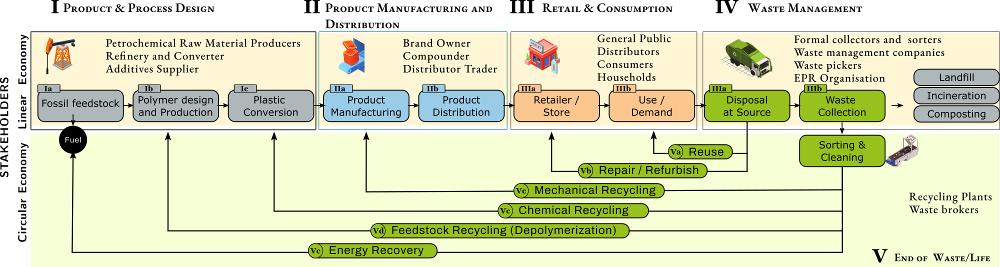

```{r setup, include=FALSE, echo=FALSE}
knitr::opts_chunk$set(echo = FALSE, fig.retina = 3, message = FALSE, warning = FALSE)
options(knitr.kable.NA = '')

library(tidyverse)
library(kableExtra)
library(readxl)
library(here)

```


# Executive summary {.unnumbered}

This document constitutes the Deliverable *D3.1 –  Benchmarking Study* of the Work Package 3: *Multi-actor collaborations for just and safe plastic’s circular economy*. 
The main goal of the document is to present a comparative analysis of international plastic reuse and recovery practices. More precisely, this document entails the development of two TechTraPlastiCE's tasks:


1. **Task T3.1:** Reuse action clues in Argentina, Chile and Colombia
2. **Task T3.3**: Assessment of local reuse systems and benchmarking with impactful reuse practices

The scope of this report is twofold. 
In a first hand, a comprehensive analysis of the socioeconomic impacts of plastic reuse initiatives in Argentina, Chile, and Colombia is identified and analyzed including aspects such as including the state of norms and processes, job creation, income generation, and economic empowerment, particularly among marginalized communities. 
In a second hand, the analysis is complemented by an exploration of how such challenges have been solved in other parts of the world (European countries, Africa, etc.) to inspire action possibilities in preparation for the Search conferences task and for the development of the *Work Package 4 Pilot projects implementation*.  

A total of 54 experiences were mapped at the international level. Particularly, twenty-five initiatives were found in Latin America  --Argentina (9), Chile (10), and Colombia (6)--, based on a tailored questionnaire for the three countries. 
The rest of experiences (29) were mapped at the rest of the world where information was collected through a specific protocol of analysis. To better understand,  the whole set of experiences were organized into five families, each recorded in a standardized three-block record sheet and analysed against the seven-stage recovery chain. 

Regarding the experiences found in Argentina, Colombia and Chile, the total set of experiences cover packaging reuse, plastic-waste collection and recycling, industrial valorization, and technology development.  Twenty-three cases directly address the management, prevention, reuse, or transformation of plastic waste.  Across the three countries, the cases point to several recurring enabling conditions: 

1. Several leviers to impulse the reuse include aspects such as i) identified demand for circular products or services, ii) dependable material supply, iii) adequate technical and quality standards, iv) stakeholder coordination, and vi) financing arrangements suited to the operating model. 
2. Extended Producer Responsibility (EPR) schemes and recycled-content requirements can create stable obligations or markets, while public procurement and industrial off-take agreements can provide alternative demand anchors. 
3. The existence of regulation, infrastructure, or a validated technology is not sufficient on its own. Chilean refilling cases, Argentine industrial and municipal cases, and Colombian recycling ventures illustrate different vulnerabilities, from commercial dependence and dispersed logistics to certification barriers and exposure to virgin-material prices.
4. The distinction between technological progress, operational scale, and long-term viability is central to the findings. Some projects remain at research or pilot stage; others operate commercially but face financial pressure; still others have closed or were never implemented. 

On the other hand, from the twenty-nine international experiences, three cross-cutting findings complemented the perspectives found in Colombia, Chile: 

(i) the points on ‘communication’ and ‘separation at source’ remain as major pain points at the value chain. 

(ii) circular economy systems that partially fail because of an imbalance between push (supply-side) and pull (demand-side) forces. Nevertheless, reference systems institutionalize both. 

(iii) the sorting and marketing stages concentrate well-designed mechanisms with very little independent performance evidence — a gap in the literature that the Deliverable 5 benchmarking can help to fill.

In general, it is recommended that before scaling any resulting reuse action, it is required to match technologies to real demand, designing viable logistics and cost-sharing arrangements, validating materials and market access, including recovery actors appropriately, and testing resilience. They also identify practical roles for universities as research partners, independent testing and certification-support institutions, living laboratories, conveners, and technology-transfer facilitators. 

Overall, the findings provide a comparative understanding of the factors that shape plastic reuse initiatives in Argentina, Chile, and Colombia. By identifying common opportunities, recurring barriers, and practical lessons from both successful and unsuccessful experiences, the study provides evidence to support decision-making, strengthen stakeholder collaboration, and inform future circular economy actions in Latin America.


# Introduction


TechTraPlastiCE project aims to implement a multi-actor approach to a just and safe plastic’s circular economy in the context of Colombia, Chile, and Argentina. 
The identified problems involving multi-actors visions and roles are foreseen to be problems that are also faced in other countries and cities. 
The benchmarking will help to find inspiration in how similar multilevel problems have been approached to start identifying clues for actions. The benchmarking study is structured with two major focuses:

1. **Advances in the reuse challenge in the context of Colombia, Chile, and Argentina.**
2. **Global benchmarking on strategies in the rest of the world, including Europe, Africa, and other countries of Latin America.**

These two perspectives aim to give the TechTraPlastiCE consortium a baseline of initiatives that have been implemented with a multicriteria grid lecture. 
In order to understand the advances, the following section will define the plastic value chain in the frame of circular economy practices and the typology of .


## Plastic Value Chain at the Circular Economy


The lifecycle of polymer materials [@johansen2022] can be described by the scheme in Fig. @fig-pvc from the extensive polymer science literature [@ragaert2017; @singh2017c]. 
Five major stages are considered as follows, particularly for Latin America [@rodriguez-meza2026]: 


:::{.landscape}
{#fig-pvc width="100%"}
:::


1. Product & Process design, 
2. Product manufacturing and distribution, 
3. Retail and consumption,
4. Waste Management
5. End-of-Waste/life.


The first stage, **Product and Process design**, relates to the upstream value chain where the raw material producers transform oil-based products into the different monomers used in the plastic industry. The primary stakeholder in this stage is the plastics producer, which refines crude oil and produces monomers that are chemically bonded into polymers. The different combinations of monomers and their blending with oxygen, chlorine, fluorine, and nitrogen generate different types of plastics. It is during the design phase that the function and qualities of the product are decided (e.g., colour, recyclability, polymer mix) [@johansen2022]. In this phase most interactions are built in business to business (B2B).

The second stage**, Product manufacturing and distribution**, encompasses the transformation of raw polymer materials into intermediate or finished plastic products, followed by their transportation and delivery across supply chains. Manufacturing activities typically involve polymer processing technologies such as extrusion, injection molding, blow molding, thermoforming, and other conversion processes, depending on the intended application and product specifications. This stage involves, particularly, the industrial actors and logistics providers for the final and intermediate products. Here, business-to-business (B2B) and business-to-consumer (B2C) interactions are mapped. For instance, the packaging industrial sector remains the largest field of application.

The third stage, **Retail and consumption**, includes the commercialization, acquisition, utilization, and use of plastic products by businesses, institutions, and final consumers. It represents the interface between the production system and the demand side of the plastic value chain, where purchasing decisions, consumption patterns, and product-use behaviors influence material demand and subsequent waste generation. Business-to-consumer (B2C) interactions are relevant in this phase.

The fourth stage, **Waste Management**, usually engages the activities and infrastructure required for the collection, transportation, sorting, treatment, and recovery of plastic waste generated during manufacturing, distribution, retail, and consumption. Its primary objective is to manage discarded plastic materials while minimizing environmental impacts and maximizing opportunities for resource recovery. In function of the national context, usually public and public-private partnerships including municipal authorities, waste collection companies, sorting facilities, recycling operators, informal waste collectors, and regulatory institutions. Waste management systems may address both pre-consumer plastic waste, generated during industrial and commercial activities, and post-consumer plastic waste, arising after products have been used and discarded.

Finally, the fifth stage, **End-of-Waste / Life**, encompasses the activities and infrastructure required for circular economy actions. This stage is particularly of interest to TechTraPlastiCE because it determines whether discarded plastics are recovered as secondary resources, converted into energy, permanently disposed of, or released into the environment. In this state, globally, we can identify the following strategies : 


  - **Reuse:** it refers to the repeated use of plastic products or components for their original purpose, without substantial modification of their material structure [@rinder2026]. It may involve collection, cleaning, inspection, repair, and redistribution operations. By extending the service life of products, reuse reduces the demand for virgin materials, limits waste generation, and avoids the environmental impacts associated with the manufacture of new products. Its implementation generally requires appropriate product design, reverse logistics, consumer participation and economically viable business models.

  - **Mechanical recycling**: mechanical recycling consists of recovering and reprocessing plastic waste through physical operations, such as sorting, washing, shredding, melting and extrusion, without intentionally altering the chemical structure of the polymers. These steps may occur in a different order, multiple times depending on the origins and composition of the waste. The resulting secondary raw materials can be incorporated into the manufacture of new plastic products, partially or entirely replacing virgin polymers. However, the effectiveness of mechanical recycling depends on the purity and homogeneity of waste streams, the presence of contaminants and additives, and the degradation of polymer properties during successive processing cycles. These limitations may lead to applications with lower technical requirements and economic value, a phenomenon commonly referred to as *downcycling*.

 - **Chemical recycling**: it encompasses a range of technologies that intentionally modify or break down the molecular structure of plastic polymers to recover monomers, oligomers, or other chemical intermediates. Processes such as hydrolysis, glycolysis, methanolysis and enzymatic depolymerisation can enable the *production of new polymers* with properties comparable to those of virgin materials. Chemical recycling can complement mechanical recycling by addressing certain waste streams that are difficult to process mechanically. Nevertheless, its environmental and economic performance depends on energy requirements, chemical consumption, conversion yields, technological maturity, and the availability of suitable feedstock.

 - **Feedstock recycling**: feedstock recycling refers to the conversion of plastic waste into basic chemical substances or hydrocarbon feedstocks that can be reintegrated into industrial production processes. Technologies such as pyrolysis, gasification and hydrothermal conversion transform polymers into products such as pyrolysis oils, synthesis gas or other chemical fractions. Unlike selective depolymerisation, feedstock recycling does not necessarily seek to recover the original monomers of a specific polymer. It offers potential opportunities for the treatment of mixed or contaminated plastic waste and the substitution of fossil-based industrial feedstocks. Its contribution to material circularity depends, however, on the extent to which the recovered substances are used to manufacture new materials rather than fuels. 

 - **Energy recovery**: Energy recovery involves the conversion of the calorific value of plastic waste into useful energy, typically through controlled combustion in waste-to-energy facilities or co-processing in industrial installations, such as cement kilns. Although this strategy can reduce landfill disposal and partially substitute conventional energy sources, it results in the irreversible loss of the material resources contained in plastics and generates greenhouse gas emissions. Consequently, energy recovery is not considered a material recycling strategy and occupies a lower position in the waste management hierarchy. It is generally regarded as a residual treatment option for plastic waste that cannot be reused or recycled under technically, economically, and environmentally acceptable conditions.

The different strategies for the circular economy of plastics present advantages and challenges given the technological maturity, the regulatory aspects, and the stakeholders involved. This is why the goal of this report is to present an overview of the experiences. 


## Typologies of the Plastic Value Chain

Five typological axes were defined to classify the differents initiatives and ground a selection criteria.
Even if most of the initiatives presents a different nature, the main purpose here is to  draw certain comparisons criteria in order to snapshot the scope. 
Each case receives a position on each axis:

1. **Regulatory axis**: It aims to give the nature of the rationale of the initiative. This axis may include: 
    - Mandatory EPR 
    - Economic incentive
    - Rights-based recognition 
    - voluntary/market-based
    - no framework 

2. **Governance**:  This axis aims to establish in what extent the initiative is manged.  
  -  (state-led · municipal · cooperative-community · private-corporate · hybrid); 

3. the waste-picker inclusion axis (exclusion · precarious outsourcing · remunerated co- management · cooperative ownership) — 
4. the axis of greatest political weight for the project context; the maturity-scale axis (pilot · consolidated · mature); and 

5. the technological axis (low · medium · high · frontier).


- Governance axis: centralised state · municipal · cooperative-community · private-corporate ·
hybrid.
- Waste-picker inclusion axis: exclusion · precarious outsourcing · remunerated co-management ·
cooperative ownership. The axis of greatest political weight for the project context.
- Maturity-scale axis: pilot (<5 years) · consolidated (5–15) · mature (15+, international
reference).
- Technological axis: low (manual) · medium (digitised registration) · high (end-to-end
traceability, AI, blockchain) · frontier (new valorisation routes).


# Reuse Action Clues in Argentina, Chile and Colombia

The task T3.1, Reuse Action Clues, forms part of Work Package 3 of the TechTraPlastiCE project and examines how plastic circular-economy initiatives are initiated, implemented, sustained, and potentially transferred across Argentina, Chile, and Colombia. 

This section provides a comparative analysis of 25 documented questionnaires: nine from Argentina, ten from Chile, and six from Colombia. The main focus is on prevention, reuse, collection, recycling, and valorization of plastic waste, complemented by two Colombian research experiences in bio-based polymer inputs that illustrate related technology-transfer challenges.

This study examines how the regulatory environment, value-chain position, institutional arrangements, markets, financing, and technical requirements interact at initiative level. 
It deliberately includes commercially operating initiatives, collective management systems, projects at research or pilot stage, cases facing operational stress, and discontinued or unimplemented efforts. 
Their differences provide contrasting evidence about the conditions necessary to translate circular-economy concepts into sustained practice.
The assessment draws on information collected through a standardized questionnaire applied by the participating universities of TechTraPlastiCE. 
The information collection and comparative analysis procedures are described in Section 2.

The study aims to identify *practical lessons for project partners* and other stakeholders, with particular attention to the contributions universities and research institutions can make beyond technical invention: materials characterization, prototyping, validation against standards, industry coordination, entrepreneurship support, and the design of viable pathways for technology adoption. 
Findings are interpreted cautiously where the questionnaire does not establish verified material flows, profitability, employment effects, or definitive causes of discontinuation.


## Regional Context for Reuse Initiatives

Previous analyses (D1.1 and D1.2) developed within the TechTraPlastiCE project identified significant differences in the regulatory and industrial conditions shaping plastic circularity in Argentina, Chile, and Colombia (see @tbl-legal). 
These contextual factors provide a basis for interpreting the reuse and valorization initiatives examined in this deliverable.


```{r }
#| echo: false
#| warning: false
#| label: tbl-legal
#| tbl-cap: "Regulatory And Policy Frameworks" 

library(readxl)

table <- 
tribble(
~"Dimension",
~"Argentina",
~"Chile",
~"Colombia",

"National CE/plastics law",
"No unified national circular economy law; federal system causes uneven provincial implementation. Sector-specific EPR exists only for phytosanitary packaging (Law 27,279, 2016).",
"Consolidated national framework: EPR Law No. 20,920 (2016), with measurable targets and high-level coordination.",
"Rapid recent progress: National Circular Economy Strategy and resolutions (e.g., Res. 1407/2018) explicitly including waste pickers.",

"EPR for packaging",
"Not yet enacted at national level for general packaging.",
"In force since 2016; implementing regulations rolled out 2021-2023.",
"In force; explicitly links producer responsibility to recycler formalization.",

"Recycler formalization",
"Cooperatives and waste pickers face variable recognition and organizational capacity; conditions differ across provinces.",
"Cooperatives and waste pickers operate under varied arrangements; EPR implementation expands formal service opportunities but does not include all material flows.",
"Formal recognition within public waste-management services; gaps in income stability and inclusion persist.",

"Domestic resin production",
"Yes (e.g., Bahía Blanca petrochemical hub).",
"Limited domestic virgin-resin production; substantial dependence on imported resins.",
"Yes (national petrochemical and resin companies).",
"Key structural barrier (per D1.2)",
"Lack of comprehensive CE regulatory framework; unfavourable tax/customs treatment of recycled inputs; weak labour regulation for recyclers.",
"Certification pathways for novel recycled-plastic products; regional collection and processing gaps.",
"Persistent informality despite formal recognition; income volatility limits incentives to formalize further."
)


table %>% 
  kbl(booktabs = T,
    linesep = "\\midrule\\addlinespace") %>%
   kable_styling(full_width = F,                 
                font_size = 10) %>% 
   row_spec(0, color = "white", background = "Naranja", bold = T, font_size = 13) %>%
   column_spec(1, bold = F, width = c("2cm"))  %>%
   column_spec(2, width = c("4cm"))  %>%
   column_spec(3, width = c("4cm"))  %>%
   column_spec(4, width = c("4cm"))  
   

```


In the case of Chile, it has implemented a national EPR framework for packaging with collective producer systems such as *ReSimple* and the agro-industrial *CampoLimpio* system. 
On the other hand, Colombia combines packaging EPR and recycled-content measures with a distinct framework for recognizing waste pickers.
Lastly, Argentina lacks a general national packaging EPR scheme but has sector-specific obligations, including for phytosanitary containers. 
These cases show that regulatory timing matters: *some initiatives were established voluntarily before later legislation strengthened their markets, while others were created to fulfill a legal obligation*.

Previous analyses also identified relevant structural differences across the plastics value chain. 
In Argentina and Colombia have established domestic polymer and petrochemical production, while Chile relies strongly on imported virgin resins. 
The Recycling networks differ in their degree of formal recognition and their ability to supply industrial users consistently. 
Nevertheless, in all three countries, the available cases demonstrate that the presence of collection infrastructure does not automatically ensure sufficient volumes, uniform quality, reliable end markets, or long-term income for recovery actors.

These differences help explain why reuse and valorization initiatives evolve differently across the three countries. 
The analysis presented in this deliverable examines how these regulatory and structural conditions are reflected at the initiative level, and how they influence implementation, stakeholder participation, financial sustainability, and scalability.


\newpage

## Methodology

### Information Collection

A standardized questionnaire was developed for Task T3.1 (Annex A) and the actions were coordinated by the Pontificia Universidad Católica de Valparaíso (PUCV). 

The questionnaire was distributed to partner universities in Argentina, Chile, and Colombia, which were responsible for identifying and documenting relevant initiatives in their respective countries.
The questionnaire addressed six analytical dimensions: 

(i) the initiative's role within the plastics value chain; 
(ii) regulatory drivers and constraints; 
(iii) stakeholders involved; 
(iv) mechanisms enabling stakeholder coordination; 
(v) environmental, economic, and social impacts; and 
(vi) sustainability and scalability.

The partners were also asked to identify key lessons learned, referred to as <<*Reuse Action Clues*>>, and to include discontinued or unsuccessful experiences where possible.
The raw database was collected in two rounds during 2026: an initial round between May and June, followed by a complementary round between September and October. 

Depending on the initiative, responses were based on direct institutional involvement, consultations with relevant stakeholders, or secondary sources, including scientific publications, institutional documentation, company reports, and publicly available information.

### Data Organization and Comparative Analysis

The completed questionnaires were consolidated and reviewed using a common analytical framework. 
Each initiative was examined individually to identify its main characteristics, reported outcomes, enabling conditions, implementation barriers, and factors influencing its continuity.
A qualitative thematic analysis was subsequently conducted to identify recurring patterns and differences across initiatives and countries. 
The comparison focused on the interaction between regulatory conditions, stakeholder collaboration, technological capabilities, market demand, financing mechanisms, material supply, logistics, and socioeconomic impacts.

Particular attention was given to contrasting initiatives at different stages of implementation, including discontinued experiences, to identify the conditions that facilitated or hindered their development. 

The findings were then synthesized into *Reuse Action Clues*, highlighting lessons with potential relevance for other Latin American contexts.
Given the diversity of initiatives and information sources, the analysis was qualitative rather than statistical. 


## Results in Argentina, Chile and Colombia

Table @tbl-results presents the initiatives included in the comparative assessment, using a unique identifiers. 

The study included 25 documented questionnaires: nine from Argentina, ten from Chile, and six from Colombia. 
These were selected to capture a diversity of circular economy approaches, organizational models, and implementation experiences.

The completed questionnaires are provided in Annex B for further details on each initiative.


:::{.landscape}

```{r }
#| echo: false
#| eval: true
#| include: true
#| warning: false
#| label: tbl-results
#| tbl-cap: "Summary of the 25 documented initiatives (status and strategies harmonized for analysis)" 


table <- 
tribble(

~"ID",
~"Initiative name",
~"Country",
~"Status",
~"Type",
~"Key actors",

"i1",
"Campo Limpio",
"Argentina",
"Active (mandatory EPR)",
"Valorization",
"110+ registrant companies; UNS/PLAPIQUI; 93 collection centres",
"i2",
"ECOPEK / CabelmaPET",
"Argentina",
"Inactive (closed 2026)",
"Valorization",
"Alpek/DAK Americas; Fundación Banco de Plásticos",
"i3",
"Fundación Garrahan Recycling Programme",
"Argentina",
"Active",
"Valorization (solidarity recycling)",
"Hospital Garrahan; 350+ collection points nationwide",
"i4",
"GIRSU Viedma",
"Argentina",
"Operating, materially contracted since 2024",
"Regional collection and sorting",
"COTRANVI; municipalities; IDB-backed infrastructure",
"i5",
"Botellas de Amor",
"Argentina",
"Reported inactive; scope of local continuity unclear",
"Recovery for recycled-plastic products",
"Community initiatives; collection networks; downstream recyclers",
"i6",
"RFG: Recycled-Plastic Railway Sleepers",
"Argentina",
"Active",
"Valorization (mechanical recycling, structural products)",
"RFG; Belgrano Cargas y Logística; CNRT; IRAM; INTI; CNEA; UNC",
"i7",
"CEVE: Recycled-plastic construction components",
"Argentina",
"Partially implemented (1 of 5 municipalities)",
"Recycled-plastic construction products",
"CEVE/CONICET-AVE; five Córdoba municipalities",
"i8",
"Cosmetics take-back/refill (sectoral comparison)",
"Argentina",
"Mixed schemes; separately operated",
"Refill, take-back and recycling (plus glass contextual case)",
"Natura; IWÖKA; Alma Raíz (glass, contextual only)",
"i9",
"Fundación Boreal: Plastic Caps to Eyeglass Frames",
"Argentina",
"Active (factory opened 2025)",
"Valorization (mechanical recycling, social end use)",
"Fundación Boreal; Boreal Salud and CMC branches; Embassy of Germany (funding); schools and companies",
"i10",
"Algramo",
"Chile",
"Inactive (closed 2025)",
"Reuse (smart refillable containers / B2B dispensing technology)",
"Algramo/Bringo; Unilever; Nestlé; Walmart/Líder; Coca-Cola; Lidl UK; Dalus Capital",
"i11",
"CirCCUlar: rPET Plant (CCU)",
"Chile",
"Active",
"Valorization (mechanical recycling, bottle-to-bottle rPET, food-grade)",
"CCU; ReSimple; Pacto Chileno por los Plásticos / Fundación Chile; base recyclers; Colbún",
"i12",
"EcoCarga",
"Chile",
"Active",
"Reuse (smart dispensing / refill model)",
"EcoCarga; Demaria; Mallplaza; Municipalidad de Providencia; Pacto Chileno por los Plásticos",
"i13",
"Palmeta: Recycled plastic cladding",
"Chile",
"Precommercial R&D / prototype (TRL 4–6)",
"Mechanical recycling and new product design",
"Desafío Ambiente; LEMAA-USACH; CORFO; ANID",
"i14",
"Redciclach: Smart collection containers",
"Chile",
"Operating; expansion reported",
"IoT-enabled collection and recycling services",
"Redciclach; USACH; retail and municipal clients",
"i15",
"ReSimple",
"Chile",
"Operating EPR system",
"Producer-financed packaging recovery coordination",
"Producer members; municipalities; contracted recyclers; cooperatives",
"i16",
"LEIND–Qactus: 3D-printing scraps",
"Chile",
"Never implemented",
"Proposed mechanical recycling to filament",
"LEIND-USACH; Qactus",
"i17",
"SUMI: Recycled plastic acoustic resonator",
"Chile",
"Precommercial R&D (TRL 5 reported)",
"Recycled-plastic acoustic product",
"LEMAA-USACH; Desafío Ambiente; Sonoflex; ANID",
"i18",
"TriCiclos",
"Chile",
"Operating according to questionnaire",
"Collection services, traceability and eco-design",
"TriCiclos; companies; municipalities; recycling operators",
"i19",
"CampoLimpio Chile: Agricultural packaging",
"Chile",
"Operating, formal EPR system since 2023",
"Controlled collection and recycling; no container reuse",
"AFIPA; 21 producer companies; farmers; contracted recyclers",
"i20",
"Bio-based polyols from oils and UCO",
"Colombia",
"Research inactive; not commercialized",
"Bio-based polymer precursors (adjacent case)",
"Universidad Nacional; Team Foods; Cenipalma; Espumlatex",
"i21",
"Bio-based plasticizers for PVC",
"Colombia",
"Research ongoing; not commercialized",
"Bio-based polymer additives (adjacent case)",
"Universidad Nacional; Université de Lorraine; Carboquímica",
"i22",
"Polyrec / Litoplas",
"Colombia",
"Operating",
"Mechanical recycling of flexible plastics; PCR products",
"Polyrec; Litoplas; collection associations; artisans",
"i23",
"Pyrcom: Plastic-waste pyrolysis",
"Colombia",
"Operating; break-even challenges reported",
"Chemical recycling / pyrolysis",
"Pyrcom; Esenttia; Ecopetrol; recovery actors",
"i24",
"Reciclene / Grupo Plastilene",
"Colombia",
"Operating",
"Mechanical recycling and PCR resin development",
"Reciclene; Plastilene; waste pickers; universities",
"i25",
"EkoRed / ENKA",
"Colombia",
"Operating",
"PET collection network and industrial recycling",
"ENKA; EkoRed; 700+ suppliers; beverage producers",
)

#write_csv2(table, file = "PUCV.csv")

table %>%
  kbl(booktabs = T, longtable = T, 
    linesep = "\\midrule\\addlinespace") %>%
   kable_styling(full_width = F,                 
                font_size = 10) %>% 
   row_spec(0, color = "white", background = "Naranja", bold = T, font_size = 12) %>%
   column_spec(1, bold = F, width = c("1cm"), latex_valign = "m")  %>%
   column_spec(2, width = c("3cm") )  %>%
   column_spec(3, width = c("3cm"))  %>%
   column_spec(4, width = c("3cm"))  %>%
   column_spec(5, width = c("3cm"))  %>%
   column_spec(6, width = c("3cm"))  
   

```

:::


The following section compares the 25 documentary cases while distinguishing circular strategies and maturity. 
The analysis follows the main dimensions of the T3.1 questionnaire and examines recurring patterns and differences regarding:

1) circular economy strategies, 
2) regulatory conditions, 
3) stakeholder collaboration, socioeconomic impacts, sustainability, scalability, and the factors associated with discontinued or at-risk initiatives.
4) Environmental, Economic and Social Impacts


### Role in the Circular Economy

The initiatives analyzed operate at different stages of the plastics value chain reflecting a diversity of circular economy strategies. 
These range from preventing packaging waste through reuse and refill systems to recovering discarded plastics and transforming them into secondary raw materials or new products. 
Although some initiatives combine several approaches, their contributions can be broadly understood through three main functions: reuse, collection and recovery, and material recycling and valorization.

**Reuse-oriented initiatives** seek to extend the useful life of plastic packaging and reduce the need for single-use containers. 
In Chile, Algramo (i10) and EcoCarga (i12) introduced refill systems that allow consumers to repeatedly use the same packaging. 
Similar practices are documented in the Argentine cosmetic-packaging case (i8), although the initiatives included in that record differ in their approaches and materials. Unlike recycling, these models aim to prevent waste generation by keeping packaging in use.

**Collection and recovery** initiatives focus on organizing material flows after consumption, connecting waste generators with recycling and valorization processes. 
Examples include Campo Limpio in Argentina (i1), Redciclach (i14), ReSimple (i15), TriCiclos (i18), and CampoLimpio in Chile (i19). 
These initiatives contribute through collection infrastructure, material separation, logistics, traceability, and coordination among stakeholders. 
Their role is particularly important in ensuring that discarded materials can reach appropriate treatment and recycling facilities.

**Recycling and material valorization** initiatives transform plastic waste into secondary raw materials or products for new applications. 
These include industrial recycling operations such as CirCCUlar (i11), Polyrec (i22), Reciclene (i24), and EkoRed/ENKA (i25), as well as initiatives developing construction components, railway sleepers, acoustic products, and other applications for recovered plastics. 
Pyrcom (i23) introduces a chemical recycling approach, while several university-linked initiatives explore new applications through research and technological development. 
These experiences represent different technologies and stages of maturity, from laboratory prototypes to industrial operations.

In general, the cases illustrate how circular economy strategies can intervene at different points of the plastics value chain. 
Their contributions are not limited to the transformation of discarded materials but also include preventing waste generation, facilitating recovery, and developing new applications for recycled plastics.

### Regulatory drivers and Constraints at Initiative Level

Regulatory frameworks influence the development of reuse and valorization initiatives by establishing responsibilities, creating incentives, and defining the conditions under which recovered materials can re-enter productive processes. 
Across the three countries, the documented experiences illustrate how different policy instruments can support circular economy practices, while also revealing regulatory gaps that may constrain their implementation and scaling.

Extended Producer Responsibility (EPR) schemes provide clear examples of how regulation can establish structured mechanisms for waste collection and recovery. 
Argentina's Campo Limpio (i1) operates under a sector-specific framework for phytosanitary packaging, while Chile's ReSimple (i15) and CampoLimpio (i19) coordinate producer-financed systems for packaging waste. 
These arrangements create formal responsibilities and financing mechanisms for waste management. 
Nevertheless, their implementation continues to face challenges related to collection infrastructure, territorial coverage, and the availability of qualified recycling operators, particularly for specialized waste streams.

Regulatory requirements can also encourage industrial demand for recycled materials. 
CirCUlar in Chile (i11) and EkoRed in Colombia (i25) illustrate how recycled-content requirements and packaging regulations can reinforce investments in PET recycling and its reintegration into beverage packaging. 
In Argentina, the recycled-plastic railway sleepers initiative (i6) demonstrates a different mechanism, where public procurement created an opportunity for industrial adoption, supported by the development of a specific technical standard (IRAM 1610). 
These experiences suggest that regulatory incentives and public purchasing can support market development when accompanied by technical requirements and identifiable demand.
However, regulation has not always been the initial driver of circular economy initiatives. TriCiclos (i18), EcoCarga (i12), and Redciclach (i14) in Chile, as well as the Campo Limpio programs in Argentina and Chile, originated as voluntary initiatives before the implementation of their most relevant subsequent regulatory frameworks. 
Their experiences illustrate how public policies can reinforce existing practices and create new opportunities for expansion, rather than necessarily triggering their development.

The cases also reveal regulatory and standardization barriers affecting emerging applications of recycled plastics. 
In Chile, SUMI (i17) and Palmeta (i13) face certification and technical validation requirements associated with the use of recycled materials in construction-related products. 
In contrast, the development of the IRAM 1610 standard in Argentina helped establish technical specifications for recycled-plastic railway sleepers (i6). The experience of CEVE (i7), however, shows that technical validation alone does not ensure implementation when other conditions, particularly investment in production infrastructure, remain unresolved.

Overall, the findings indicate that regulation can facilitate circular economy initiatives through financing obligations, market incentives, public procurement, and technical standardization. Nevertheless, its effectiveness depends on the capacity of initiatives and their stakeholders to translate these instruments into viable operations. Regulatory support is therefore an important enabling condition, but not a sufficient guarantee of long-term sustainability.

###  Stakeholders and alignment mechanicsm

The initiatives analyzed involve a diverse range of stakeholders, including companies, universities, research institutions, public authorities, producer associations, recyclers, cooperatives, and consumers. Their experiences show that effective collaboration depends not only on bringing different actors together, but also on establishing complementary roles, shared objectives, and mechanisms that enable sustained coordination.

Universities and research institutions play different roles depending on the nature and development stage of each initiative. 
In Chile, LEMAA-USACH contributed research, product design, and technical validation to SUMI (i17) and Palmeta (i13), working alongside companies with manufacturing expertise and potential market access. In Argentina, the National University of Córdoba supported material characterization in the RFG railway-sleeper initiative (i6), while CEVE/CONICET (i7) assumed a more central role in technology transfer and collaboration with municipalities. 
In Colombia, Universidad Nacional led research on biobased polymer inputs (i20 and i21), connecting scientific capabilities with industrial interests. 
These experiences illustrate different forms of academic contribution, from technological development to applied research and knowledge transfer.

Universities can also facilitate entrepreneurship and early-stage validation. 
Redciclach (i14), for example, benefited from USACH's innovation ecosystem and used the university campus to test its technology and engage users before expanding to other institutional and commercial settings. 
In contrast, Reciclene (i24) describes collaboration with universities through applied projects, technical challenges, and knowledge exchange, while industrial leadership remains with the company. 
These cases demonstrate that university involvement does not necessarily require leading an initiative, but can contribute through specific technical and innovation capabilities.

In other initiatives, industrial companies act as the main coordinating actors, connecting material recovery with processing and manufacturing. 
EkoRed/ENKA (i25), Polyrec/Litoplas (i22), and Reciclene/Plastilene (i24) illustrate arrangements in which established industrial actors connect recyclers and material suppliers with downstream production. 
Their coordination is supported by complementary capabilities, material-quality requirements, and identifiable commercial applications. 
Similarly, Fundación Boreal (i9) connects plastic-cap collection with an established social program that provides a defined use for the recovered material.

Collective management systems rely on institutional coordination among producers, regulators, waste managers, and other participants. 
ReSimple (i15) and CampoLimpio Chile (i19) illustrate the role of established industry organizations in bringing together companies and organizing shared waste-management responsibilities. 
Argentina's Campo Limpio (i1) provides another example of sectoral coordination for specialized packaging waste. 
These initiatives demonstrate the importance of institutional structures capable of connecting actors with different responsibilities across the recovery chain.

Other initiatives have encouraged participation by offering different benefits to different stakeholders. Redciclach (i14) provides traceability information for institutions, incentives for users, and more organized material flows for recyclers. EcoCarga (i12) connects consumer savings with the interests of product manufacturers and retail partners, while TriCiclos (i18) combines waste-management services, information, and collaboration with public and private organizations. Fundación Garrahan (i3), meanwhile, illustrates how institutional credibility and a recognized social purpose can mobilize participation beyond direct economic incentives.
However, the cases also show that common objectives and complementary capabilities do not automatically result in effective collaboration. The LEIND–Qactus initiative (i16) did not progress because essential operational arrangements, including material volumes, transportation, responsibilities, and economic conditions, were not resolved. SUMI (i17) also encountered difficulties in establishing a collaboration involving proprietary manufacturing knowledge. These experiences highlight the need for clear agreements addressing responsibilities, expectations, technical contributions, and the management of shared risks.
Taken together, the findings suggest that stakeholder alignment is strengthened when collaboration is organized around clearly defined roles, complementary capabilities, mutual benefits, and appropriate coordination mechanisms. The experiences also illustrate the potential contribution of universities as technology developers, technical partners, facilitators, and innovation-support institutions within circular economy value chains.

### Environmental, Economic and Social Impacts

The documented initiatives report a range of environmental, economic, and social outcomes, reflecting their different positions within the plastics value chain. 
However, the nature and availability of impact data vary considerably across cases. 
While some initiatives provide information on recovered materials, production volumes, or packaging avoided, others primarily report employment, economic benefits, or community participation. 
These differences must be considered when interpreting and comparing their contributions.


#### Environmental and Material Outcomes

The initiatives analyzed demonstrate different contributions to plastic circularity, from preventing waste generation and improving collection to reincorporating recovered materials into new production cycles. 
Their environmental outcomes reflect the diversity of strategies implemented, providing evidence of how plastic consumption and waste management practices can be transformed at different stages of the value chain.

Reuse and refill systems demonstrate the potential to reduce plastic waste at its source by extending the useful life of packaging. 
In Chile, EcoCarga (i12) reports having avoided approximately 221 tonnes of single-use plastic, equivalent to more than 1.38 million disposable containers, through its refill model. 
Algramo (i10) and the refill practices documented in Argentina's cosmetic-packaging case (i8) illustrate complementary approaches to reducing disposable packaging consumption. 

Collection and recovery initiatives contribute by recovering post-consumer materials and directing them towards appropriate treatment and valorization processes. 
Argentina's Campo Limpio (i1) reported capturing approximately 4.6 million kilograms of empty phytosanitary containers in 2024, while CampoLimpio Chile (i19) recovered 932 tonnes of agricultural packaging waste in 2025. 
Beyond the volumes collected, these initiatives establish organized recovery channels for materials requiring specific handling procedures. Other experiences demonstrate the contribution of collection systems for widely dispersed consumer waste. 
Fundación Garrahan (i3) reports having recovered more than 7,927 tonnes of plastic caps between 2006 and 2026, while Redciclach (i14) collected more than 27,000 PET bottles during its initial university-campus pilot between August 2022 and November 2023. 

Industrial recycling initiatives demonstrate how recovered plastics can be reintegrated into manufacturing processes, creating alternatives to virgin raw materials. 
CirCCUlar (i11) in Chile and EkoRed/ENKA (i25) in Colombia have developed industrial pathways for transforming post-consumer PET into recycled resin suitable for new beverage packaging. Reciclene/Grupo Plastilene (i24) provides a more specific example of material substitution: between November 2022 and October 2024, a collaborative project produced approximately 2,080 tonnes of shrink film containing 10% post-consumer recycled resin, incorporating approximately 208 tonnes of recovered plastic into new packaging. Polyrec (i22), meanwhile, demonstrates opportunities for recovering flexible plastic packaging and transforming it into secondary materials for manufacturing. 

Other initiatives contribute by developing alternative applications for recovered plastics, extending the range of products in which these materials can be used. 
In Argentina, RFG (i6) has developed recycled-plastic railway sleepers, while CEVE (i7) transferred technology for manufacturing construction components from recycled PET, with one municipality reaching an estimated production of 500 bricks per month. 
In Chile, SUMI (i17) and Palmeta (i13) have explored applications in acoustic and construction products through technological development and pilot-scale validation. 
Although these university-linked initiatives have not all reached commercial production, they demonstrate opportunities to transform recovered plastics into products with specific technical functions, potentially expanding markets for recycled materials beyond conventional packaging applications.

The cases also illustrate different approaches to the recovery of materials that are difficult to reintegrate into conventional recycling processes. 
Pyrcom (i23), for example, processes mixed plastic waste through pyrolysis to obtain liquid products, representing a distinct valorization pathway whose environmental contribution depends on the subsequent use of those outputs.

Overall, the documented experiences show that environmental contributions arise through several complementary mechanisms: reducing the consumption of disposable packaging, recovering post-consumer materials, replacing virgin inputs in manufacturing, and developing new applications for plastic waste. While the evidence is not sufficient to quantify the net environmental benefits of every initiative, the reported outcomes demonstrate tangible progress across different stages of the plastics value chain.


#### Economic Value and Employment

Several industrial initiatives involve recovery actors but provide different levels of evidence for job creation and income effects. 

Reciclene/Plastilene (i24) reports approximately 30 direct jobs and relationships reaching around 900 recyclers per month in 2024, while an estimate of more than 5,000 indirectly benefited recyclers is not a headcount of verified new jobs. 
Polyrec/Litoplas (i22) documents a partnership involving 83 artisans and participation by waste-picker organizations; it does not quantify resulting income gains.
GIRSU Viedma (i4) illustrates that social outcomes can be reversed. 
The cooperative’s workforce reportedly grew from 12 to about 80 during the period of improved municipal collection, but declined to approximately 17 after operational and financial conditions deteriorated from 2024. 
This case is especially important because long-term inclusion depends on continuity of service and downstream markets, not only on initial infrastructure investments.

In Chile, TriCiclos (i18) reports 125 employees across multiple service functions, but the figure covers the organization as a whole, not exclusively plastic handling. 
CirCCUlar (i11) describes direct purchasing and training arrangements involving recyclers, without sufficiently disaggregated wage or income outcomes. 
ReSimple (i15) reports engagement with recycling enterprises and cooperatives and support for certification, which should be distinguished from evidence of nationwide formalization.
Redciclach (i14) identifies jobs and functions associated with installation, maintenance, data, and logistics but does not provide a verified count of incremental employment. EkoRed (i25) describes a network of more than 700 suppliers and support measures including equipment and training; large figures for sector-wide payment or recycler reach should not be attributed exclusively to the initiative without consistent definitions.
Among other Argentine cases, CEVE (i7) reports a very small operating team at the single municipality where manufacturing began; Garrahan (i3) mobilizes an extensive solidarity collection network but offers little information on employment effects; and Fundación Boreal (i9) links recycled caps to a social-health service rather than documenting recovery-sector wages. No waste-picker outcomes can be inferred from the laboratory-stage bio-based materials research (i20 and i21).
These variations reflect the position of each initiative in the value chain. Industrial recyclers and aggregation systems interact most directly with the recovery workforce, whereas refill systems, material-science prototypes, and producer-management organizations affect labor markets through different mechanisms. Participation is therefore not equivalent to sustained improvements in income, safety, bargaining power, or decision-making.

#### Conditions of inclusion and evidence limitations
Beyond employment generation, the initiatives illustrate how circular economy practices can strengthen recycling organizations, encourage community participation, and connect material recovery with broader social benefits. 
These contributions emerge through different mechanisms, depending on the roles and opportunities created for participating actors within each initiative.

The integration of *waste pickers and recycling organizations represents an important social dimension* of several experiences. 
In Colombia, EkoRed (i25) connects waste pickers and sorting organizations with industrial recycling processes through purchasing arrangements, training, and material supply networks. 
Reciclene (i24) similarly maintains relationships with recycling networks, while Polyrec (i22) links material recovery with artisanal production. 
In Chile, ReSimple (i15) promotes the participation of recycling organizations in formal waste-management systems, including professional certification initiatives. 
Meanwhile, GIRSU Viedma (i4) in Argentina illustrates how recycling cooperatives can assume an active operational role in municipal waste management.

Community engagement also emerges as a relevant contribution. 
Fundación Garrahan (i3) has developed an extensive collection network involving schools, companies, institutions, and volunteers, linking recycling activities with a recognized social purpose. 
Similarly, Redciclach (i14) encourages participation through incentive-based collection systems, initially tested within a university environment. 
These experiences demonstrate how institutional networks and citizen engagement can support the organization of material recovery activities.

Other initiatives generate social benefits through the destination of recovered materials or the resources obtained from their valorization. Fundación Boreal (i9) transforms collected plastic caps into eyeglass frames for visual-health programs, connecting recycling with access to a socially useful product. 
Fundación Garrahan (i3), in turn, directs revenues from material recovery towards pediatric healthcare. 
Both cases demonstrate how recycling activities can be integrated into broader social initiatives, extending their contribution beyond waste management.

These experiences show that the social value of circular economy initiatives extends beyond employment creation to include organizational strengthening, community engagement, and support for social services. 
They also highlight the importance of how recycling actors are incorporated into value chains, particularly whether their participation involves structured relationships, access to training, and opportunities for organizational development, rather than being limited to supplying recovered materials.


# Comparative analysis of effective  plastic reuse and recovery practices at the rest of the World.


This section presents a comparative analysis of international plastic reuse and recovery practices developed by an external expert to the consortium. 
The first one built a universe of 29 international experiences organised into five families, each recorded in a standardised three-block record sheet and analysed against the seven-stage recovery chain. 
This work focuses on complementarity, replicability and lessons learned that the international cases can offer to Argentina, Chile and Colombia, analysed in the previous section. 

The second one develops the comparative framework — a five-axis typology, a stage-coverage matrix graded under a strict criterion, the push/pull dimension, and a matrix of dimensions and indicators aligned with the Search Conferences task of Work Package 3 — and, on that basis, proposes a shortlist of 13 candidate cases (7 representative and 6 innovation cases). 

Three cross-cutting findings were identified in this report: 

* (i) under the strict grading criterion, the gaps in the universe — communication and separation at source — coincide with the weakest stages in the region
* (ii) systems that partially fail do so because of an imbalance between push (supply-side) and pull (demand-side) forces, while reference systems institutionalize both
* (iii) the sorting and marketing stages concentrate well-designed mechanisms with very little independent performance evidence — a gap in the literature that benchmarking can help to fill. 


## Framing and Methodological approach


The survey was structured around two foundational decisions, documented in detail in the methodological note in the next sections. 

1. the universe is international, with the deliberate exclusion of Argentina, Chile and Colombia. Uruguay is included as a comparable Latin American context, and TriCiclos is recorded through its regional deployment outside Chile. 
2. Every experience is analysed against the seven-stage recovery chain, which serves as the common unit of analysis and reveals each case's partial coverage as an analytical datum in its own right.

Seven-stage recovery chain:

1. communication: Awareness-raising and citizen habit formation; who funds and delivers it
 
2. separation at source;
3. capture and logistics; sorting; 
4. marketing of recyclables; 
5. valorisation; 
6. business models 
7. innovation, 


## Push/pull dimension 

A cross-cutting dimension was incorporated into the framework, classifying each circuit's instruments according to the force that moves the material. 
The nature of each initiative was evaluated according to two perspectives:

- Push (supply side): it refers to instruments that push material into the circuit. For instance: mandatory separation, consumer deposits, pay-as-you-throw, collection mandates, EPR capture targets.

- Pull (demand side): it refers instruments that draw material from the destination. For instance: mandatory recycled content, captive or premium demand, recovery certificates, guaranteed prices. 


Each case is classified by its balance: integrated, push-dominant, pull-dominant, facilitator or imbalanced (push without pull / pull without push). 

The reading hypothesis emerging from the universe is that **systems that partially fail do so through imbalance**. For example: 

  1. Push without pull where it mobilises material and people towards circuits without a market;
  2. Pull without push: only draws the valuable material and orphans the rest.
  3. Reference systems where both forces are integrated. 


## Results in Rest of the World

The universe does not gather the 29 “best” cases; it deliberately covers the space of variation required by the terms of reference — socio-economic contexts, regulatory frameworks, levels of formalisation, governance models and operating scales. 

It includes counter-cases and partial failures (Ecuador, Brazil, the Zabbaleen), whose value lies precisely in documenting why designs fail. 


The final composition also reflects a deliberate adjustment: four redundant cases were removed (two Nordic deposit systems similar to the German benchmark; two European EPR schemes similar to those retained) and the valorisation family was reinforced from four to nine cases, as the critical stage for the regional context.

The following table summarises the full pre-selection. The verification status distinguishes cases cross-checked against 2024–2026 sources (21 of 29) from those pending verification (8, all reserve cases).


\clearpage
\newgeometry{a3paper, margin=1.5cm}


:::{.landscape}


```{r }
#| echo: false
#| eval: true
#| include: true
#| warning: false
#| label: tbl-result-manuel
#| tbl-cap: "Summary of the 25 documented initiatives (status and strategies harmonized for analysis)" 

table <- 
    read_excel(here("delivrables/tables/3.1/Tables.xlsx")) |> 
    slice(26:59) |> 
    select(ID, `Initiative Name`, Country, Family, `Push / Pull Balance`: `Bussiness Model and Innovation` )

#names(table)
#write_csv2(table, file = "PUCV.csv")

table %>%
  kbl(booktabs = T, longtable = T, 
    linesep = "\\midrule\\addlinespace") %>%
   kable_styling(full_width = F, latex_options = c("repeat_header"),                 
                font_size = 10) %>% 
   row_spec(0, color = "white", background = "Naranja", bold = T, font_size = 10) %>%
   column_spec(1, bold = F, width = c("0.5cm"), latex_valign = "m")  |> 
   column_spec(2, width = c("2cm") )  |> 
   column_spec(3, width = c("2cm"))  |> 
   column_spec(4, width = c("2cm"))  %>%
   column_spec(5, width = c("2cm"))  %>%
   column_spec(6, width = c("2cm"))  %>%
   column_spec(7, width = c("2cm"))  %>%
column_spec(8, width = c("1.5cm"))  |> 
column_spec(9, width = c("1.5cm"))  |> 
column_spec(10, width = c("1.5cm"))  |> 
column_spec(11, width = c("1.5cm"))  |> 
column_spec(12, width = c("1.5cm"))  
   

```


:::

\clearpage
\restoregeometry


Each initiative coverage of the seven stages was graded on four levels under two rules: 

1. “High” grade requires performance documented by an independent or official or  cross-checked source — a well-designed mechanism without independent metrics grades 
2. “Medium”, and self-reported data from the organisation itself cannot sustain a “High”; (ii) cases not yet verified carry at most a provisional “Medium”. 

3. The full re-grading of the universe under these rules (78 downgrades relative to the working version) restores the scale's discriminating power.

 

### Family A — Deposit-refund systems (DRS)

Deposit-refund systems attack the chain through the direct economic incentive to the consumer: the container is worth money, and so it comes back. They are the instrument with the highest documented return rates, and the four selected cases cover the spectrum without redundancy: the German technical benchmark (which also documents the Norwegian performance-modulated eco- fee), the fast Lithuanian implementation, the Australian community model, and the Ecuadorian fiscal experiment — Latin America's only one, with its design lessons.


Lesson for the project. The case shows the instrument's ceiling and also its blind spot: the design excludes the informal actor (although a subsistence circuit collecting abandoned containers exists), and the unreturned material — barely 4% — remains as revenue retained by industry. For AR/CL/CO it is the technical benchmark against which to measure any DRS. A design variant worth noting (Norway/Infinitum): a producer eco-fee modulated by the system's collective return rate, aligning private interest with collective performance.


### Family B — Mature EPR schemes

### Family C — Inclusive recycling and waste pickers

### Family D — Private and technological innovation

### Family E — Valorisation and new value chains


# Reuse Action Clues: Transferable Lessons for Latin America

The comparative analysis of initiatives in Argentina, Chile, and Colombia provides practical lessons for the development and implementation of circular economy solutions. 
These Reuse Action Clues draw on both established and discontinued experiences, identifying considerations that can help anticipate implementation barriers, strengthen collaboration, and support long-term continuity.

## Action clues supported by cross-country evidence

### Identify market demand and end uses from the outset: 

Circular solutions should be developed with a clear understanding of who will use or purchase the recovered materials, products, or services. 
RFG (i6) illustrates how an identified institutional buyer can facilitate industrial adoption, while EkoRed (i25) and Reciclene (i24) connect recycling activities with established manufacturing applications. 
These experiences highlight the importance of considering market requirements alongside technological development.

### Design collection and recovery systems around realistic material flows

Before implementation, initiatives should assess the availability, quality, location, and seasonality of recoverable materials, together with the logistics required to collect and process them. 
LEIND–Qactus (i16) illustrates the difficulties associated with insufficient material volumes and unresolved transportation arrangements, while CampoLimpio Chile (i19) demonstrates the challenges of operating recovery networks across dispersed territories.

#### Integrate technical validation, certification, and market requirements

Developing a functional technology does not necessarily ensure its adoption. SUMI (i17) and Palmeta (i13) demonstrate the importance of addressing product performance and certification requirements during technological development. In Argentina, RFG (i6) illustrates how technical standardization can facilitate the introduction of recycled-plastic products into established industrial applications.

#### Establish viable financing arrangements and anticipate operational risks 

Financing mechanisms should reflect the nature and development stage of each initiative, while ensuring that recurring operational costs can be covered. 
Producer-financed systems such as ReSimple (i15) differ substantially from commercial ventures and publicly supported research projects. Experiences such as Algramo (i10), ECOPEK (i2), and GIRSU Viedma (i4) further highlight the importance of anticipating changes in market conditions, funding availability, and stakeholder commitments.

#### Build partnerships around complementary capabilities and clear responsibilities

Effective collaboration requires more than shared environmental objectives. Partners should establish their respective contributions, responsibilities, incentives, and arrangements for managing costs and risks. 
University-industry collaborations such as SUMI (i17) and Palmeta (i13) demonstrate the value of combining research and manufacturing capabilities, while Redciclach (i14) illustrates the role of institutional environments in supporting early-stage implementation.

#### Incorporate material quality, traceability, and circular design considerations 

Recovery systems should be designed according to the technical requirements of subsequent recycling or manufacturing processes. EkoRed (i25), Reciclene (i24), and Polyrec (i22) illustrate the importance of material quality and appropriate processing pathways. 
Complementary strategies such as packaging redesign and traceability can improve the connection between collection activities and the effective reintegration of recovered materials into productive processes.

#### Integrate recycling organizations and communities into implementation strategies

The participation of waste pickers, cooperatives, and communities should be considered from the design stage, including their operational roles, access to training, working conditions, and opportunities for organizational development. Initiatives such as ReSimple (i15), EkoRed (i25), and GIRSU Viedma (i4) illustrate different forms of integration, while Fundación Garrahan (i3) demonstrates the importance of community networks in sustaining material recovery activities.

#### Monitor results to support improvement and future replication

Initiatives should establish indicators that reflect their specific circular economy strategy, including material recovery, reuse cycles, recycled-content incorporation, operational performance, and social outcomes. Experiences such as EcoCarga (i12), Reciclene (i24), and Redciclach (i14) illustrate different ways of documenting circular economy results. Monitoring should support operational learning and decision-making, rather than focusing exclusively on the volume of materials collected or processed.

### Conditions for transfer and specific university contributions

Although these lessons are relevant across the three countries, their application depends on local regulatory frameworks, industrial capabilities, infrastructure, market conditions, and stakeholder networks. Replicating a successful initiative therefore requires adapting its operational and organizational arrangements to the receiving context, rather than transferring a technology or business model without modification.

For TechTraPlastiCE, the findings highlight several opportunities for universities to strengthen technology transfer. Beyond research and product development, universities can contribute to identifying industrial needs, validating technological solutions, facilitating collaboration between stakeholders, supporting certification processes, and providing environments for pilot testing. 

Ultimately, the Reuse Action Clues emphasize that effective circular economy solutions must be developed as integrated systems, connecting technological capabilities with viable operational models, stakeholder participation, and local implementation conditions. 
This perspective provides a practical foundation for strengthening university-industry collaboration and supporting future circular economy initiatives in Latin America.


 

# References